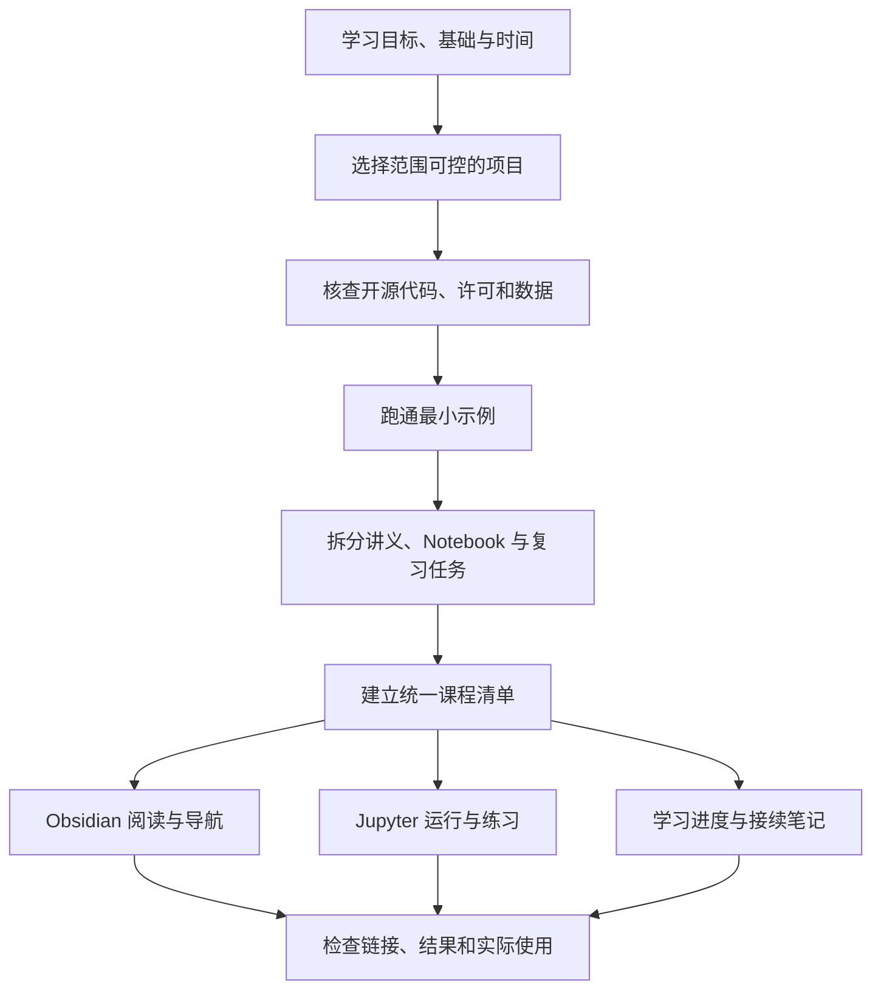

# Project Learning Studio · 项目学习工作台

**把“我想学这些技能”，变成一套有讲解、能运行、能记录进度的项目课程。**

Project Learning Studio 是一套供 AI 编程助手使用的 Skill。它将选题、开源项目筛选、中文教程编写、Obsidian 知识组织、Jupyter 实践和学习进度管理连接成一个完整流程，适合希望通过真实小项目系统学习的人。

本仓库包含 Skill 指令、分阶段参考和可修改模板。运行后产出的具体课程、数据、Python 环境及 Obsidian 进度插件，由助手根据你的主题和设备创建；这些产物并未打包在本仓库中。

## 目录

- [为什么做这个项目](#为什么做这个项目)
- [适合谁使用](#适合谁使用)
- [完整工作流程](#完整工作流程)
- [Obsidian、Jupyter 和面板如何协作](#obsidianjupyter-和面板如何协作)
- [安装与第一次使用](#安装与第一次使用)
- [可以怎样提出需求](#可以怎样提出需求)
- [课程与文件组织](#课程与文件组织)
- [学习进度的设计](#学习进度的设计)
- [仓库文件说明](#仓库文件说明)
- [示例：地理空间分析入门](#示例地理空间分析入门)
- [验证范围与当前限制](#验证范围与当前限制)
- [常见问题](#常见问题)
- [维护与贡献](#维护与贡献)

## 为什么做这个项目

自学常见的困难并不只是缺少资料。学习者可能找到一个 GitHub 项目，却不知道第一天该做什么；能复制代码运行，却无法解释输入和结果；在笔记软件里保存了大量文件，过几天又不知道上次学到了哪里。

这个 Skill 把课程设计和本地工具落地放在一起考虑。它要求助手先找到一个适合当前水平的小项目，再建立可以验证的运行流程，随后编写分课教程和练习，最后提供清晰的导航与接续记录。

核心目标是让学习者逐渐做到：能读懂、能修改、能复现、能解释。

## 适合谁使用

- 希望通过项目学习 Python、数据分析、可视化等技能的初学者。
- 已经有研究或业务方向，希望把工具学习组织成连续练习的人。
- 使用 Obsidian 记录知识，同时需要在 Jupyter 中运行代码的人。
- 有课程文件，但讲义、代码、路径和进度记录已经分散，需要重新整理的人。
- 希望根据目标岗位技能准备真实项目经历的人；项目完成后，再据实际成果整理作品说明。

如果你只需要搜索招聘信息、修改一篇笔记的排版，或者做一次独立的数据分析，通常不需要执行整个流程。

## 完整工作流程



### 1. 明确学习目标

助手先整理你想学的技能、当前基础、每天可投入的时间、兴趣领域、设备和希望完成的成果。已有信息会直接复用，缺少非关键条件时给出可调整的默认值。

目标会被写成实际任务，例如“读取一份数据，处理缺失值并解释统计图”，而不是仅列出 Pandas、Matplotlib 等工具名称。

### 2. 选择项目并核查来源

比较候选项目的技能覆盖、先修知识、运行成本、数据可用性、许可证和首个可运行示例。优先选择普通电脑能够处理、结果容易检查的小范围项目。

复用第三方项目时记录来源和具体版本，保留许可证，并说明哪些内容直接来自原项目、哪些经过改编、哪些是独立教学补充。

### 3. 先完成一个小流程

先用少量记录、一个小区域或一个短时间段，完成“读取输入 → 核心处理 → 一个结果 → 一个检查”。在确认数据、依赖和运行路线可用之后，再扩展成整套课程。

当原项目依赖私有数据或无法使用的云端资源时，说明阻断原因，评估公开小样例和独立教学实现。不同实现的范围和验证结论分别记录。

### 4. 编写能跟着学的教程

每课围绕一个可检查的小成果，配一份中文讲义与一份 Notebook。讲义包含目标、概念、准备工作、分步代码、关键语句解释、预期现象、常见错误、练习、自检答案和下一步。

Notebook 负责把代码拆成可逐格运行的单元，同时保留概念解释和练习位置。课程可以按周、阶段或章节组织，数量与节奏由你的需求决定。

### 5. 建立学习工作区

将讲义和导航放进指定的 Obsidian 库；为代码建立独立环境，提供 Jupyter 启动入口和中文操作说明。运行数据、参考项目和验证文件保留清楚的用途说明，日常入口保持简洁。

### 6. 加入学习进度面板

面板从统一课程清单获得课时、顺序、路径和技能分类。学习记录按稳定的课程 ID 保存，支持检查点、接续笔记、下一课推荐、侧栏和导出。

### 7. 实际验证并交付

检查讲义与 Notebook 是否对应、路径是否有效、核心流程能否在新内核中运行、结果是否可解释，以及 Obsidian 中的插件是否真正加载和显示。

离线与在线步骤分别记录验证结果。需要账号认证的环节由学习者完成，未运行的部分会明确标记。

## Obsidian、Jupyter 和面板如何协作

| 部分 | 主要用途 | 每天怎么用 |
| --- | --- | --- |
| Obsidian | 阅读讲义、理解概念、查找资料、写学习笔记 | 打开当天课程，边读边记录问题 |
| Jupyter | 执行代码、修改参数、观察输出、完成练习 | 打开对应 Notebook，按顺序逐格运行 |
| 学习进度面板 | 记录检查点、接续位置和已完成内容 | 学完后确认完成项，保存下次起点 |
| 课程清单 | 统一课时编号、顺序、文件路径和技能标签 | 由助手维护，避免各入口相互脱节 |

一次典型学习可以这样进行：

1. 打开面板，查看“下次从这里开始”。
2. 进入讲义，先理解当天要解决的问题。
3. 打开配套 Notebook，运行并修改代码。
4. 完成练习，对照答案解释结果。
5. 勾选实际完成的检查点，保存接续笔记。

例如：“裁剪已经跑通；下次从重投影单元开始，还需要弄清 NoData 的处理。”这比单独记录“学了第七课”更容易继续。

## 安装与第一次使用

### 运行前需要什么

- 一个支持本地 Skill 的 AI 助手，并能访问你指定的课程目录。
- 需要笔记库集成时，安装 Obsidian 并准备目标库。
- 需要执行练习时，准备或允许助手配置适合主题的 Python/Jupyter 环境。
- 获取项目与公开数据时，需要相应网络访问；仅阅读本仓库不需要登录任何云服务。

本仓库自身没有需要启动的服务器，也不包含通用的课程生成命令。助手读取 Skill 后，结合具体任务使用其可用工具执行流程。

### 安装 Skill

将整个仓库文件夹作为名为 `project-learning-studio` 的 Skill 交给助手安装。根目录的 `SKILL.md` 与 `references/`、`assets/`、`agents/` 需要一起保留。

在支持 `$skill-installer` 的环境中，可以这样说：

> 使用 $skill-installer，把这个仓库根目录的 Skill 安装为 project-learning-studio。

具体 Skill 存放位置应按所使用客户端的配置决定。本项目最初在本地 Codex 的用户 Skill 目录中使用；不要把另一个人的绝对路径原样复制到你的机器。

安装后，在助手中调用：

```text
使用 $project-learning-studio。

我想学习 Python、数据分析和可视化。
目前基础比较少，每天可以投入一小时，希望用四周完成一个小项目。
请帮我选择适合的主题，编写中文教程和 Jupyter 练习，
放进我指定的 Obsidian 库，并建立可以记录学习进度和接续位置的面板。
```

如果客户端暂未识别新 Skill，可先确认完整文件夹已安装，再按客户端提供的方法刷新技能或开启新会话。

## 可以怎样提出需求

### 新建课程

```text
使用 $project-learning-studio，帮我做一个城市气温数据分析项目。
我想练习 Pandas、缺失值处理和 Matplotlib，周期两周。
请先跑通一个小样例，再编写逐课教程、Notebook 和进度面板。
```

### 地理空间分析

```text
使用 $project-learning-studio。
我想学习 Python、GDAL、GeoPandas 和 Google Earth Engine。
请围绕一个小区域组织项目，解释坐标系、栅格、NoData 和空间统计，
并把本地可运行部分与需要我认证的云端部分分开说明。
```

### 维护已有课程

```text
使用 $project-learning-studio，检查我现有课程的讲义、Notebook、
课程清单和面板路径是否一致，保留已有学习记录，修复失效链接。
```

### 简化目录

```text
使用 $project-learning-studio，整理这个学习目录。
请先检查未命名文件夹的内容，将常用学习入口整理清楚，
保留数据和运行环境，并提供恢复方法。
```

### 增加学习阶段

```text
使用 $project-learning-studio，为已有课程增加一个统计建模阶段。
保留旧课程 ID 和进度，新增课时从新的清单条目生成导航与面板统计。
```

## 课程与文件组织

建议让学习者看到少量稳定入口：

```text
我的项目课程/
├── 00_从这里开始.md
├── 学习进度面板.md
├── 每日课程/
├── 复习练习/
└── 资料说明.md
```

工程资料仍可保留清晰的目录：

```text
course.json      课程编号、顺序、路径与技能分类
notebooks/       逐格运行的练习
data/            原始数据和处理后数据
scripts/         公共处理与验证程序
results/         图表和分析结果
references/      原始参考代码与许可信息
reports/         运行与验证记录
```

具体名称可以调整。对已有项目，优先保证程序和引用仍能运行；如需简化 Obsidian 的文件列表，可以按课程路径限定显示规则，并写明恢复完整列表的方法。

Skill 特别记录了这些整理经验：

- “未命名”不代表没有内容，要检查后再处理。
- 可以恢复的目录模板先归档，再清理日常入口。
- 改文件夹名字时，要同步讲义、Notebook、清单和面板中的路径。
- 课程 ID 保持稳定，避免重命名后丢失进度。
- 已安装的 Python/Conda 环境不能当普通资料随意移动。
- 保留已有主题，只对本课程进行必要的显示调整。

## 学习进度的设计

默认建议每课有三个手动检查点：

| 检查点 | 需要确认什么 |
| --- | --- |
| 理解讲解 | 能用自己的话解释关键概念 |
| 动手练习 | 本人运行代码或完成练习 |
| 完成自检 | 能解释结果与限制 |

三项全选计为完成，允许撤销。部分确认或主动开始表示进行中。打开讲义和助手执行代码，都不会自动计作学习者完成课程。

下一课推荐优先继续最近正在进行且未完成的课程；没有进行中课程时，按清单顺序推荐最早未完成项。全部完成后显示复习或导出入口。

面板实现指南还包括：

- 从清单计算课程总数、阶段进度和技能覆盖。
- 接续笔记保存结果可见，保存失败时保留原记录。
- 界面刷新不会丢失未保存草稿。
- 侧栏跟随当前讲义，并适合窄屏阅读。
- 保存操作按顺序执行，避免连续点击丢失更新。
- 提供 Markdown 和 JSON 导出，方便阅读与恢复。
- 在真实 Obsidian 宿主中验证打包加载和跳转。

本节描述的是 Skill 要求未来课程实现的能力。本仓库当前提供实现指南，未附一个可以直接安装到任意库的通用进度插件。

## 仓库文件说明

```text
project-learning-studio/
├── README.md
├── SKILL.md
├── agents/
│   └── openai.yaml
├── references/
│   ├── topic-selection.md
│   ├── course-and-jupyter.md
│   ├── obsidian.md
│   └── progress-panel.md
├── assets/
│   ├── course.example.json
│   ├── lesson-template.md
│   └── notebook-template.ipynb
└── docs/
    └── VALIDATION.md
```

| 文件 | 作用 |
| --- | --- |
| [SKILL.md](SKILL.md) | 助手的入口指令，说明何时使用及如何推进 |
| [选题与证据](references/topic-selection.md) | 选题、开源复用、数据和最小示例的判断方法 |
| [教程与 Jupyter](references/course-and-jupyter.md) | 逐课教学、环境、启动与运行验证 |
| [Obsidian 落地](references/obsidian.md) | 库定位、简洁导航、路径迁移和恢复 |
| [进度面板](references/progress-panel.md) | 清单、状态、保存、界面与宿主验证 |
| [课程清单示例](assets/course.example.json) | 三个示例课时，演示稳定 ID 和文件映射 |
| [讲义模板](assets/lesson-template.md) | 填写具体课程内容的结构 |
| [Notebook 模板](assets/notebook-template.ipynb) | 查找项目根目录、核对解释器和基础练习 |
| [验证说明](docs/VALIDATION.md) | 已执行检查及尚未覆盖的范围 |

`agents/openai.yaml` 保存名称、短描述和默认调用提示。示例清单中的课时路径用于说明格式，不对应仓库中已经生成的完整课程。

## 示例：地理空间分析入门

此流程最初整理自一个东北黑土地相关的入门学习项目，涉及 Python、GDAL、GeoPandas、可视化与 GEE。该案例按四周组织，包含 20 节核心课、8 个复习练习日，以及课程专用的学习进度面板。

案例积累了几项可复用经验：先用公开小数据跑通流程；每课同时提供讲解和运行练习；区分模型假设与真实测量；把云端认证单独处理；用稳定 ID 连接课程和进度；从一开始保持日常导航简洁。

四周与 28 天属于该案例的安排。新项目可以采用不同主题、周期、课时数量和分组方式。

本仓库不包含原案例的数据裁片、完整课程、机器环境、个人学习记录或个人笔记库。

## 验证范围与当前限制

当前已经执行的检查包括 Skill 格式、内部资源链接、示例清单的编号与技能引用、Notebook 结构，以及准备单元从根目录和子目录定位课程的行为。详见[验证记录](docs/VALIDATION.md)。

尚未使用这套新 Skill 独立完成第二个主题的端到端课程，也未声明跨平台、不同 Obsidian 版本或多设备同步全部验证通过。

课程执行效果取决于具体数据、依赖、设备和助手可用工具。生成的课程、环境及插件仍需要按项目进行运行与界面验证。

## 常见问题

### 这是一个已经做好的 Obsidian 插件吗？

这是一个 Skill，包含工作流程、参考文档和模板。它指导助手为具体课程构建或适配 Obsidian 面板；当前仓库没有可通用安装的插件发行包。

### 下载后能直接开始学 Python 吗？

仓库模板还需要按你的目标编写成课程。先让助手使用 Skill，提供想学的技能与基础，再生成实际讲义和 Notebook。

### 一定要四周完成吗？

不需要。时间、课时与复习频率由具体需求决定。课程清单中的分组可以表示周、阶段或章节。

### 已经有课程和进度了，还能使用吗？

可以。它支持只整理目录、修复运行问题、同步清单路径或继续课程。已有学习记录需要保留，课程编号不能因为标题改名而改变。

### 进度能判断我是否真正掌握了吗？

进度记录由学习者确认。技能条表示相关课程的完成覆盖，不能当作独立能力评测。练习、自检、修改代码和解释结果仍是学习的重要部分。

### 是否需要 shushu-internship-tool？

它是可选辅助。如果目标偏向岗位项目，可以利用已安装的该 Skill 比较候选项目；本工作流自身也可以完成选题。

### 会自动登录 GEE 或其他云服务吗？

账号认证由用户完成。课程应把尚未认证或未执行的在线步骤明确标记，并尽量提供能够独立学习的本地部分。

### 如何分享我的课程？

先检查课程中的数据和第三方代码许可，再去除账号信息、访问令牌、个人学习记录和本机路径。分享环境声明并说明如何重建环境，不要将整个本机运行环境当作可移植安装包。

## 维护与贡献

欢迎基于真实使用问题提出改进。反馈时说明操作系统、相关软件版本、具体步骤、期望结果和实际现象；提供可公开的最小样例即可。

优先改进会影响教学、路径、运行和进度可靠性的实际问题。修改模板后，应重新验证对应行为；新增复杂机制前，先说明它解决了哪个已观察到的问题。

当前仓库尚未指定开源许可证。第三方项目、数据和生成课程中的资源应分别遵循各自许可；公开可访问本身不等于授予任意复制与再分发的许可。

Skill 文件结构的官方说明见 OpenAI Developers 的 “Build skills” 文档：`https://developers.openai.com/plugins/build/skills`。
